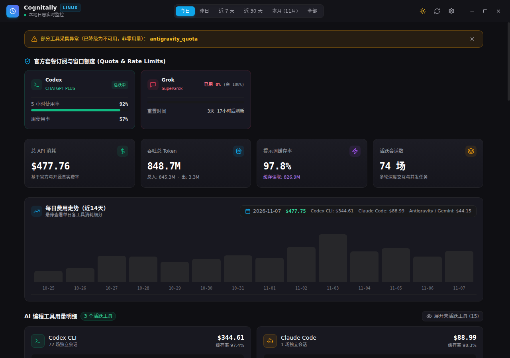

<div align="center">

# 🧠 Cognitally (formerly TokDash)

**Sovereign AI Coding Agent Observability, Token Ledger & MCP Budget Guard for Linux, macOS & Windows**

*Zero-latency passive stream accounting across 14 mainstream AI coding agents + Read-only Autonomous MCP Budget Defense.*

[](https://github.com/kamanager2012/tokdash-releases/releases)
[](#-quick-install-one-liner)
[](https://modelcontextprotocol.io/)
[](#-local-first-security--privacy)
[](LICENSE)

[简体中文](README.md) | **English**

[Quick Install](#-quick-install-one-liner) • [Preview](#-desktop--terminal-preview) • [CLI Reference](#-cli-command-reference) • [MCP Setup](#-mcp-plug-and-play) • [Statusline](#-millisecond-terminal-statusline) • [14 Supported Agents](#-14-supported-ai-coding-agents) • [Verify & Uninstall](#-verification-upgrade--uninstall)

</div>

---

## 🖼️ Desktop & Terminal Preview



> Above: Electron desktop overview (synthetic demo snapshot). In any interactive terminal, running `cognitally` (or `cognitally --summary` in scripts) renders an aligned multi-period ledger table with cache hit rates and live quota bars:

```text
Cognitally (TokDash) — Local AI Coding Agent Observatory  [snap:b0465d55 | view:today]
======================================================================================
  Today: $12.40 (3.20M)  |  Yesterday: $18.10 (4.85M)  |  7d: $94.20 (24.1M)  |  All-Time: $420.50 (110.4M)
======================================================================================
Agent                         In       Out  Cache Read   Hit %    Reason   Cost (USD)
--------------------------------------------------------------------------------------
Claude Code                45.2k    118.4k      2.10M   97.9%         0 $      6.42
Codex CLI                 120.0k     92.1k    610.5k   83.6%     41.2k $      4.18
Antigravity / Gemini       84.0k     38.5k    180.0k   68.2%     12.0k $      1.80
--------------------------------------------------------------------------------------
TOTAL                     249.2k    249.0k      2.89M   92.1%     53.2k $     12.40

Live Subscription Quotas
  Codex 5h     [█████░░░░░░░░░░░]  34.0%  (reset 11-18 20:00)
```

---

## 💡 Why Cognitally / TokDash?

Developers running autonomous coding agents such as **Claude Code, Codex CLI, Cursor, and Qoder** face three recurring challenges:
1. **Runaway Token Loops**: Overnight agent test runs burn dozens of dollars before anyone notices.
2. **Fragmented Multi-Agent Billing**: Token spend and subscription windows are scattered across 4–5 tools with no unified daily ledger.
3. **Proxy Overhead & Privacy Risk**: MITM HTTP proxies add latency, break TLS setups, and risk exposing private prompts.

**How Cognitally solves it:**
- **Zero Proxy, Zero Network Overhead**: Passive, single-flight local log and SQLite parsing protected by atomic snapshots — zero traffic interception.
- **Unified Financial Ledger Across 14 Agents**: Separates Input, Output, Cache Read, Cache Write, and Reasoning tokens with strict pricing provenance.
- **Proactive Read-Only MCP Budget Guard (`check_budget`)**: Lets coding agents inspect remaining budget headroom and quotas over standard Model Context Protocol (2024-11-05) before launching heavy reasoning loops.

---

## ⚡ Quick Install (One-Liner)

> **Prerequisites**: **Python >= 3.8** only (100% CPython standard library — zero external `pip` dependencies).

### 🐧 Linux / macOS
Install the standalone zipapp executable into `~/.local/bin` (creates both `cognitally` and `tokdash` symlink):

```bash
curl -fsSL https://raw.githubusercontent.com/kamanager2012/tokdash-releases/main/install.sh | bash
```

<details>
<summary>Advanced options (custom directory / skip doctor / local clone install)</summary>

```bash
# Custom install dir and skip post-install --doctor
COGNITALLY_INSTALL_DIR="$HOME/bin" curl -fsSL https://raw.githubusercontent.com/kamanager2012/tokdash-releases/main/install.sh | bash -s -- --no-doctor

# Install directly from a local git clone with SHA256SUMS verification
git clone https://github.com/kamanager2012/tokdash-releases.git
cd tokdash-releases && bash install.sh --local
```

</details>

### 🪟 Windows (PowerShell)
Run in PowerShell (filters out Windows Store `python.exe` stub aliases automatically):

```powershell
irm https://raw.githubusercontent.com/kamanager2012/tokdash-releases/main/install.ps1 | iex
```

Verify your setup immediately:

```bash
cognitally                      # Interactive terminal summary table + quota bars
cognitally --summary --period all
cognitally --help
cognitally --doctor
cognitally --statusline
```

---

## 🧭 CLI Command Reference

| Command | Description | Key Options |
| :--- | :--- | :--- |
| `cognitally` / `--summary` | Render aligned multi-period cost strip, agent table, quota bars & top workspaces | `--period today\|yesterday\|week\|month\|all`, `--no-color`, `--bitbar` |
| `cognitally --doctor` | Probe 14 AI coding agents, log health, and 400+ model prices | `--json` |
| `cognitally --statusline` | Emit a fast single-line status badge from snapshot cache | `--period today\|yesterday\|week\|month\|all`, `--format default\|compact\|cost\|tokens\|json`, `--no-icons`, `--force` |
| `cognitally --install-statusline` | Print shell snippets for Bash, Zsh, Tmux, and Starship | — |
| `cognitally --budget-check` | Evaluate spending against a USD budget threshold | `--budget-limit <USD>`, `--period ...`, `--notify`, `--json` |
| `cognitally --mcp` | Launch the read-only Stdio MCP 2024-11-05 server | — |
| `cognitally --export <fmt>` | Export canonical dataset (JSON or formula-safe CSV) | `json` / `csv`, `--period ...`, `--out <file>` |
| `cognitally --daily-costs` | Print per-day multi-agent expense breakdown | — |
| `cognitally --projects` | Print per-workspace / repository token & cost attribution | — |
| `cognitally --quota-detail` | Print subscription quota windows and reset countdowns | — |
| `cognitally --wrapped` | Print historical usage & streak summary | — |
| `cognitally --snapshot` | Build and print canonical snapshot metadata | — |
| `cognitally --version` / `-V` | Print version immediately without scanning logs | `--json` |
| `cognitally --help` / `-h` | Print CLI usage reference immediately without scanning logs | — |

---

## 🔌 MCP Plug and Play

Cognitally ships a strictly read-only Stdio MCP server (`2024-11-05`). Connect any compatible agent:

### 1. Claude Code
```bash
claude mcp add cognitally -- cognitally --mcp
```

### 2. OpenAI Codex CLI
Add to `~/.codex/config.toml`:
```toml
[mcp_servers.cognitally]
command = "cognitally"
args = ["--mcp"]
```

### 3. Cursor
Add to `~/.cursor/mcp.json`:
```json
{
  "mcpServers": {
    "cognitally": {
      "command": "cognitally",
      "args": ["--mcp"]
    }
  }
}
```

### 4. Windsurf / Zed / Cline
Add to `mcp_config.json`:
```json
{
  "mcpServers": {
    "cognitally": {
      "command": "cognitally",
      "args": ["--mcp"]
    }
  }
}
```

#### Exposed Read-Only MCP Tools (7):
- `check_budget` — Evaluate current spend against configured threshold and return remaining headroom.
- `get_usage` — Inspect input, output, cache read/write, reasoning tokens, and session counts.
- `get_cost` — Query agent cost breakdown and 7-day spending trend.
- `get_quota` — Read live quota windows and reset countdowns (Codex, Claude, Cursor, etc.).
- `get_projects` — Aggregate spend and sessions by local workspace/repository.
- `get_models` — Break down spend per LLM model with pricing provenance.
- `get_accounting_status` — Inspect snapshot health, generation digest, and collector diagnostics.

---

## 💻 Millisecond Terminal Statusline

```bash
cognitally --install-statusline
```

Preview:
```text
⚡ $12.40 | 3.2M tok | 4 agents
```
- Single-line output safe for Bash `PS1`, Zsh `PROMPT`, Tmux status bars, and Starship modules.
- Supports `--format compact`, `--format cost`, `--format tokens`, and `--format json`.

---

## 🤖 14 Supported AI Coding Agents

| # | AI Coding Agent | Local Log / Store Targets | Status |
| :-: | :--- | :--- | :---: |
| 1 | **Claude Code** | `~/.claude/projects/**/*.jsonl` transcript stream | `✅` |
| 2 | **OpenAI Codex CLI** | `~/.codex/{sessions,archived_sessions}/**/*.jsonl` incremental stream | `✅` |
| 3 | **Cursor Composer** | `~/.config/Cursor/.../state.vscdb` & `agent-transcripts` | `✅` |
| 4 | **Google Antigravity / Gemini** | `~/.gemini/`, `~/.antigravity/` & local protocol store | `✅` |
| 5 | **Grok Build** | `~/.grok/sessions/` & `~/.tokei/` unified billing logs | `✅` |
| 6 | **Grok Bot** | `~/.grok-bot/` & Application Support persistence blobs | `✅` |
| 7 | **GLM Code (ZCode)** | `~/.zcode/cli/db/db.sqlite` passive ledger | `✅` |
| 8 | **Qoder (IDE & CLI)** | `~/.qoder/` & `SharedClientCache` SQLite databases | `✅` |
| 9 | **CodeBuddy / WorkBuddy** | `~/.codebuddy/`, `~/.workbuddy/`, `~/.workbuddy-ai/` | `✅` |
| 10 | **Kimi Code** | `~/.kimi-code/sessions/**/wire.jsonl` protocol logs | `✅` |
| 11 | **DeepSeek Harness** | `~/.dsh/sessions/**/*.jsonl.zstd` compressed sessions | `✅` |
| 12 | **OpenCode** | `~/.opencode/` & `~/.local/share/opencode/` SQLite/JSON | `✅` |
| 13 | **Hermes Agent** | `~/.hermes/` runtime state database | `✅` |
| 14 | **Pi Agent CLI** | `~/.pi/agent/` & `~/.omp/agent/sessions/` session runs | `✅` |

---

## 🛡️ Local-First Security & Privacy

- **100% Local Processing**: All log parsing, pricing attribution, and SQLite reads run strictly on your workstation — no prompts, code, or telemetry are uploaded.
- **Read-Only Passive Access**: Never injects network proxies or mutates agent config files.
- **Artifact Integrity**: Pure CPython standard library distribution verified by [`SHA256SUMS`](SHA256SUMS) and Zipapp validation before installation.

---

## 🔐 Verification, Upgrade & Uninstall

### Verify Checksums (`SHA256SUMS`)
```bash
# Linux / macOS
curl -fsSLO https://raw.githubusercontent.com/kamanager2012/tokdash-releases/main/SHA256SUMS
sha256sum -c --ignore-missing SHA256SUMS
```

```powershell
# Windows PowerShell
Get-FileHash .\cognitally.pyz -Algorithm SHA256
```

### Upgrade
Re-run the one-line installer for your OS to replace the executable atomically while preserving local caches and ledgers.

### Uninstall
```bash
# Linux / macOS
curl -fsSL https://raw.githubusercontent.com/kamanager2012/tokdash-releases/main/install.sh | bash -s -- --uninstall
```

```powershell
# Windows PowerShell
powershell -ExecutionPolicy Bypass -File .\install.ps1 -Uninstall
```

---

## 📦 Release & Support

- **Latest Release**: `v0.1.0` — see [CHANGELOG.md](CHANGELOG.md)
- **Issues & Feedback**: [GitHub Issues](https://github.com/kamanager2012/tokdash-releases/issues)

---

## 📜 License

Binaries, zipapps, and installer scripts in this repository are licensed under the **[Cognitally / TokDash Proprietary End User License Agreement (EULA)](LICENSE)**:
- **Free for Personal Use**: Personal developers may download and run the software locally for monitoring, evaluation, and non-commercial research.
- **All Rights Reserved**: Unauthorized commercial resale, redistribution, reverse engineering, or hosted SaaS offering is prohibited.
