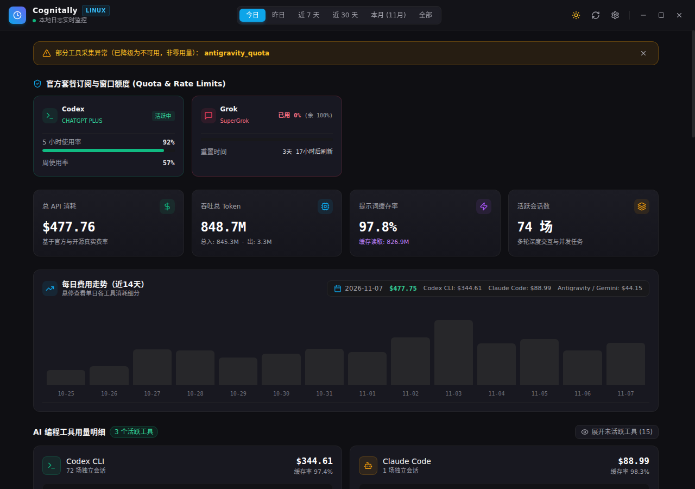

<div align="center">

# 🧠 Cognitally (formerly TokDash)

**Sovereign AI Coding Agent Observability, Token Ledger & MCP Budget Guard for Linux, macOS & Windows**

*Zero-latency passive stream accounting across 14 mainstream AI coding agents + Read-only Autonomous MCP Budget Defense.*

[](https://github.com/kamanager2012/tokdash-releases/releases)
[](#-快速安装一行流)
[](https://modelcontextprotocol.io/)
[](#-安全与隐私声明-local-first-guarantee)
[](LICENSE)

**简体中文** | [English](README.en.md)

[快速开始](#-快速安装一行流) • [界面预览](#-桌面端与终端预览) • [CLI 命令参考](#-cli-命令全量参考) • [MCP 智能体配置](#-mcp-智能体即插即用) • [终端状态栏](#-毫秒级终端状态栏-statusline) • [支持的 14 款 Agent](#-支持的-14-款-ai-coding-agent) • [校验与卸载](#-完整性校验升级与卸载)

</div>

---

## 🖼️ 桌面端与终端预览



> 上图为 Electron 桌面端总览（演示用合成快照预览）；命令行直接输入 `cognitally`（或在脚本中调用 `cognitally --summary`）即可秒出多周期、多 Agent 对齐账单与配额进度条：

```text
Cognitally (TokDash) — Local AI Coding Agent Observatory  [snap:b0465d55 | view:today]
======================================================================================
  Today: $12.40 (3.20M)  |  Yesterday: $18.10 (4.85M)  |  7d: $94.20 (24.1M)  |  All-Time: $420.50 (110.4M)
======================================================================================
Agent                         In       Out  Cache Read   Hit %    Reason   Cost (USD)
--------------------------------------------------------------------------------------
Claude Code                45.2k    118.4k      2.10M   97.9%         0 $      6.42
Codex CLI                 120.0k     92.1k    610.5k   83.6%     41.2k $      4.18
Antigravity / Gemini       84.0k     38.5k    180.0k   68.2%     12.0k $      1.80
--------------------------------------------------------------------------------------
TOTAL                     249.2k    249.0k      2.89M   92.1%     53.2k $     12.40

Live Subscription Quotas
  Codex 5h     [█████░░░░░░░░░░░]  34.0%  (reset 11-18 20:00)
```

---

## 💡 为什么选择 Cognitally / TokDash？

当开发者高频使用 **Claude Code、Codex、Cursor、Qoder** 等自主编程智能体时，普遍面临三大痛点：
1. **“Token 刺客”**：睡觉前让 Agent 自动跑重构测试，早上一看死循环刷爆卡里几十刀；
2. **“多 Agent 碎片化”**：机器上装了 4、5 款 Agent，各个平台账单割裂，无法核算每日总体研发成本；
3. **“传统代理损耗”**：云端监控或中间人代理（Proxy）会劫持网络、增加请求延迟、甚至有泄露私有提示词的风险。

**Cognitally 的核心解法：**
- **零网络代理、零延迟损耗**：采用纯标准库并发原子快照，在底层被动单飞解析本地日志与 SQLite 会话，CPU 占用趋近于 0，不经过任何外部转发。
- **14 款 Agent 财务级统一账本**：全口径覆盖国内外主流工具，精准识别 Input / Output / Cache Read / Cache Write / Reasoning 真实 Token 消耗与定价溯源。
- **主动式 MCP 预算守卫 (`check_budget`)**：通过标准 Model Context Protocol (2024-11-05) 让 AI Coding Agent 在执行重型推理前自查预算水位，严守只读零写入边界。

---

## ⚡ 快速安装（一行流）

> **前置依赖**：仅需系统自带 **Python >= 3.8**（纯 CPython 标准库实现，零第三方 `pip` 依赖）。

### 🐧 Linux / macOS
在终端中直接运行官方独立可执行包一键安装脚本（默认安装到 `~/.local/bin`）：

```bash
curl -fsSL https://raw.githubusercontent.com/kamanager2012/tokdash-releases/v0.1.2/install.sh | bash
```

<details>
<summary>高级安装参数（自定义路径 / 跳过自检 / 本地安装）</summary>

```bash
# 指定安装目录并跳过安装后 --doctor 自检
COGNITALLY_INSTALL_DIR="$HOME/bin" curl -fsSL https://raw.githubusercontent.com/kamanager2012/tokdash-releases/v0.1.2/install.sh | bash -s -- --no-doctor

# 从本地仓库克隆直接安装（含 SHA-256 校验）
git clone https://github.com/kamanager2012/tokdash-releases.git
cd tokdash-releases && bash install.sh --local
```

</details>

### 🪟 Windows (PowerShell)
在 PowerShell（普通用户权限即可，自动过滤 Windows Store Python 空壳占位符）中运行：

```powershell
irm https://raw.githubusercontent.com/kamanager2012/tokdash-releases/v0.1.2/install.ps1 | iex
```

安装完成后，全局自动获得 `cognitally` 及兼容别名 `tokdash` 命令：

```bash
# 直接在交互式终端运行：自动输出多 Agent 彩色汇总表格与配额进度条
cognitally

# 查看特定时间周期汇总（today / yesterday / week / month / all）
cognitally --summary --period all

# 查看命令行使用说明与全量参数
cognitally --help

# 诊断本机 14 款主流 Agent 安装与日志健康度
cognitally --doctor

# 极速输出当前 Token 消耗与预算状态
cognitally --statusline
```

---

## 🧭 CLI 命令全量参考

| 命令 | 说明 | 常用选项 |
| :--- | :--- | :--- |
| `cognitally` / `--summary` | 在终端输出多周期成本条、Agent 对齐表、配额进度条与 Top 模型/项目 | `--period today\|yesterday\|week\|month\|all`、`--no-color`、`--bitbar` |
| `cognitally --doctor` | 探测 14 款 Agent 日志健康度、文件数与 400+ 模型定价库 | `--json` |
| `cognitally --statusline` | 输出毫秒级单行终端状态徽标（复用原子快照缓存） | `--period today\|yesterday\|week\|month\|all`、`--format default\|compact\|cost\|tokens\|json`、`--no-icons`、`--force` |
| `cognitally --install-statusline` | 打印适用于 Bash、Zsh、Tmux、Starship 的终端配置片段 | — |
| `cognitally --budget-check` | 核验指定周期消耗是否超出美元预算阈值 | `--budget-limit <USD>`、`--period ...`、`--notify`、`--json` |
| `cognitally --mcp` | 启动标准 Stdio MCP 2024-11-05 只读服务 | — |
| `cognitally --export <fmt>` | 导出规范化账本数据集（JSON 或防公式注入 CSV） | `json` / `csv`、`--period ...`、`--out <file>` |
| `cognitally --daily-costs` | 输出跨 Agent 每日花费与明细对账 | — |
| `cognitally --projects` | 按工作区 / 代码仓库归集 Token 与花费 | — |
| `cognitally --quota-detail` | 输出主流订阅配额窗口与重置倒计时 | — |
| `cognitally --wrapped` | 生成历史用量与活跃连续天数总结 | — |
| `cognitally --snapshot` | 构建并输出规范快照元数据（Generation SHA-256） | — |
| `cognitally --version` / `-V` | 极速输出当前版本信息（不触发全量扫描） | `--json` |
| `cognitally --help` / `-h` | 极速打印 CLI 参数速查手册（不触发全量扫描） | — |

---

## 🔌 MCP 智能体即插即用

Cognitally 原生内置标准 Stdio MCP 2024-11-05 协议服务。通过以下配置，即可让编程智能体拥有“开销自省”与“预算防线”能力：

### 1. Claude Code
```bash
claude mcp add cognitally -- cognitally --mcp
```

### 2. OpenAI Codex CLI
在 `~/.codex/config.toml` 中添加：
```toml
[mcp_servers.cognitally]
command = "cognitally"
args = ["--mcp"]
```

### 3. Cursor
在 `~/.cursor/mcp.json` 中添加：
```json
{
  "mcpServers": {
    "cognitally": {
      "command": "cognitally",
      "args": ["--mcp"]
    }
  }
}
```

### 4. Windsurf / Zed / Cline
在客户端 `mcp_config.json` 中添加：
```json
{
  "mcpServers": {
    "cognitally": {
      "command": "cognitally",
      "args": ["--mcp"]
    }
  }
}
```

#### 智能体可用工具清单（7 个工具，严格只读）：
- `check_budget`：智能体自主评估今日/当周/当月消耗是否越界，返回剩余可用额度；
- `get_usage`：查询输入、输出、缓存读写与思维链 Token 明细；
- `get_cost`：查询各 Agent 与每日花费趋势；
- `get_quota`：读取 Codex、Claude、Cursor 等实时额度窗口与重置倒计时；
- `get_projects`：按工作区/代码仓归集用量与花费；
- `get_models`：按具体 LLM 模型分析开销与定价来源；
- `get_accounting_status`：获取当前天文台日志解析探针与快照健康状态。

---

## 💻 毫秒级终端状态栏 (Statusline)

将当天 AI 编程消耗与额度预警随手挂载到日常终端中：

```bash
# 查看适用于 Bash / Zsh / Tmux / Starship 的装配指引
cognitally --install-statusline
```

### 效果预览：
```text
⚡ $12.40 | 3.2M tok | 4 agents
```
- **单行零换行**：安全嵌入 Bash `PS1`、Zsh `PROMPT`、Tmux 状态行与 Starship 自定义模块；
- **多输出模式**：支持 `--format compact`（`$12.40 (3.2M)`）、`cost`、`tokens` 与 `json`；
- **毫秒级返回**：复用原子快照缓存，无感知极速输出。

---

## 🤖 支持的 14 款 AI Coding Agent

| # | AI Coding Agent | 本地观测路径与采集方式 | 核心指标与自检状态 |
| :-: | :--- | :--- | :---: |
| 1 | **Claude Code** | `~/.claude/projects/**/*.jsonl` 会话转录流解析 | 输入/输出/缓存读写/Quota · `✅` |
| 2 | **OpenAI Codex CLI** | `~/.codex/{sessions,archived_sessions}/**/*.jsonl` 增量流解析 | 输入/输出/缓存/推理/Quota · `✅` |
| 3 | **Cursor Composer** | `~/.config/Cursor/.../state.vscdb` 与 `agent-transcripts` | 会话用量/月度花费/重置倒计时 · `✅` |
| 4 | **Google Antigravity / Gemini** | `~/.gemini/`、`~/.antigravity/` 与本地协议解码聚合 | 每步 Token/5h 窗口配额 · `✅` |
| 5 | **Grok Build** | `~/.grok/sessions/` 与 `~/.tokei/` 本地结构化账单 | 实时 API Token/窗口配额/成本 · `✅` |
| 6 | **Grok Bot** | `~/.grok-bot/` 与系统 Application Support 持久化 Blob | Bot 交互轮次与 Token 吞吐 · `✅` |
| 7 | **GLM Code (ZCode)** | `~/.zcode/cli/db/db.sqlite` SQLite 本地账本被动核算 | 智谱 GLM 系列 Token 与推理明细 · `✅` |
| 8 | **Qoder (IDE & CLI)** | `~/.qoder/` 与 `SharedClientCache` 本地 SQLite 数据库 | 多端 IDE/Work/CLI 统一核算 · `✅` |
| 9 | **CodeBuddy / WorkBuddy** | `~/.codebuddy/`、`~/.workbuddy/`、`~/.workbuddy-ai/` | 腾讯系编码助手增量日志解析 · `✅` |
| 10 | **Kimi Code** | `~/.kimi-code/sessions/**/wire.jsonl` 协议流解析 | 模型路由、缓存读写与 Token · `✅` |
| 11 | **DeepSeek Harness** | `~/.dsh/sessions/**/*.jsonl.zstd` 压缩流原生解压核算 | 输入/输出/缓存/推理与成本 · `✅` |
| 12 | **OpenCode** | `~/.opencode/` 与 `~/.local/share/opencode/` SQLite/JSON | DeepSeek / 本地模型会话统计 · `✅` |
| 13 | **Hermes Agent** | `~/.hermes/` 本地状态数据库跟踪 | 权威会话账本与成本归集 · `✅` |
| 14 | **Pi Agent CLI** | `~/.pi/agent/` 与 `~/.omp/agent/sessions/` 会话追踪 | 工具调用、缓存读写与上下文 Token · `✅` |

---

## 🛡️ 安全与隐私声明 (Local-First Guarantee)

- **完全本地化**：所有会话分析均在您的本地机器完成，绝不向任何第三方服务器上传您的代码、Prompt 或敏感上下文；
- **只读零侵入**：以只读方式被动访问本地既有日志文件与数据库，不篡改 Agent 原始配置，不建立网络中间人拦截；
- **供应链安全与发行溯源**：核心路径 100% CPython 标准库，安装脚本在覆盖既有程序前强制下载并校验 [`SHA256SUMS`](SHA256SUMS) 与 Zipapp 完整性（失败不覆盖旧版）；包内嵌入 `BUILD_MANIFEST.json`，可通过 `cognitally --version --json` 验证构建对应的源码提交 (`source_commit`)。

---

## 🔐 完整性校验、升级与卸载

### 1. SHA-256 完整性校验与构建溯源
在线一键安装会自动拉取同版本 `SHA256SUMS` 并强制执行 fail-closed SHA-256 比对；如需手工核验：

```bash
# Linux / macOS
curl -fsSLO https://raw.githubusercontent.com/kamanager2012/tokdash-releases/v0.1.2/SHA256SUMS
sha256sum -c --ignore-missing SHA256SUMS
cognitally --version --json
```

```powershell
# Windows PowerShell
Get-FileHash .\cognitally.pyz -Algorithm SHA256
cognitally --version --json
```

### 2. 升级到最新版本
重新运行对应平台的一键安装命令即可先在临时文件完成校验再原子切换覆盖，历史本地会话账本与缓存配置完全保留；校验失败则原安装文件保持不变。

### 3. 干净卸载
```bash
# Linux / macOS
curl -fsSL https://raw.githubusercontent.com/kamanager2012/tokdash-releases/v0.1.2/install.sh | bash -s -- --uninstall
```

```powershell
# Windows PowerShell
powershell -ExecutionPolicy Bypass -File .\install.ps1 -Uninstall
```

---

## 📦 发布说明与技术支持

- **最新版本**：`v0.1.2`（Linux / macOS 跨版本单文件可执行 `cognitally` & Windows 原生 `cognitally.pyz`）
- **变更日志**：详见 [CHANGELOG.md](CHANGELOG.md)
- **问题反馈与建议**：欢迎在 [GitHub Issues](https://github.com/kamanager2012/tokdash-releases/issues) 提交反馈与功能提案。

---

## 📜 许可协议 (License)

本项目分发的二进制制品、可执行文件与配套脚本遵循 **[Cognitally / TokDash 专有最终用户许可协议 (EULA)](LICENSE)**：
- **个人免费使用**：允许个人开发者出于本地监控、评估与研发观测目的免费下载与运行；
- **专有权利保留**：保留全部专有知识产权与商标权；
- **禁止商业转售与逆向**：严格禁止未经授权的商业转售、重新打包分发、反编译/逆向工程，或作为云端商业托管服务提供。
